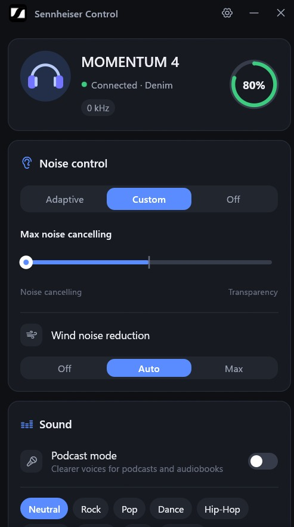
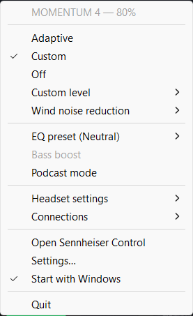

# Sennheiser Control

A small Windows tray app I slopped into existence in my free time to get a semblance of control of the
**Sennheiser MOMENTUM 4** headphones under Windows, because Sennheiser didn't think anyone would use these with a
computer or something.

It talks to the headphones directly over Bluetooth. No phone, no account, no cloud.

## What it does

- Battery level in the tray
- Noise control: Adaptive, Custom (noise cancelling ⟷ transparency) and Off, plus wind reduction
- EQ: Neutral, Sennheiser's presets, your own presets and a Custom curve, plus bass boost and podcast mode
- Pretty much everything else the Smart Control Plus app does for the M4: Hi-Res, call settings, on-head
  detection, touch lock, auto power-off, prompts, multipoint, factory reset

Enough of it works to keep me satisfied, and I didn't care to investigate anything beyond that. If you find
something that doesn't work, [open an issue](https://github.com/xndbogdan/sennheiser-control/issues) and complain
there.

## Other Sennheiser headphones (experimental)

These speak the same protocol as the M4, so the app tries them too. Each one only gets the features Sennheiser's own
app offers for it:

- ACCENTUM Wireless and ACCENTUM Plus Wireless
- ACCENTUM True Wireless
- MOMENTUM True Wireless 3 and 4
- MOMENTUM Sport

I only own an M4, so none of these have been tested. Everything is taken from how Sennheiser's app talks to them.
If something misbehaves, attach `%APPDATA%\SennheiserControl\sennheiser-control-error.log` to your issue. With
these models the app writes the model and firmware there when it connects, followed by every command the headset
turns down and any crash.

Not supported: the CX earbuds (Sennheiser's app reaches those over Bluetooth LE only), and older models like the
MOMENTUM 3, PXC 550, HD 450BT or the first two MOMENTUM True Wireless, which use a different protocol.

## Getting started

1. Pair the headphones with Windows and connect them.
2. Grab `sennheiser-control.exe` from [Releases](https://github.com/xndbogdan/sennheiser-control/releases) and
   run it. There's no installer. Windows will grumble because it isn't signed: *More info → Run anyway*.
3. Left-click the tray icon for the window, right-click for the quick menu. Closing the window keeps the app in
   the tray; *Quit* is in the menu. Want it at login? Tray menu → *Start with Windows*. Tick *Start minimized* too
   if it should start in the tray without opening the window.

   

## Good to know

- Low-battery alerts are regular Windows notifications, so they only show up if notifications are on.
- Tested on M4 firmware 3.38.3.
- Crashes and errors go to `%APPDATA%\SennheiserControl\sennheiser-control-error.log`.
- Not there yet: renaming the headphones, the multipoint on/off switch, prompt volume.

## Nerd stuff

Building, flags and code layout are in [`DEVELOPMENT.md`](DEVELOPMENT.md). How the headset protocol works (all
reverse-engineered from Sennheiser's apps) is in [`PROTOCOL.md`](PROTOCOL.md).

---

Unofficial, not affiliated with Sennheiser. For my personal use and pleasure, uses the Sennheiser logo because it
looks nice. Will remove if they complain I guess.
